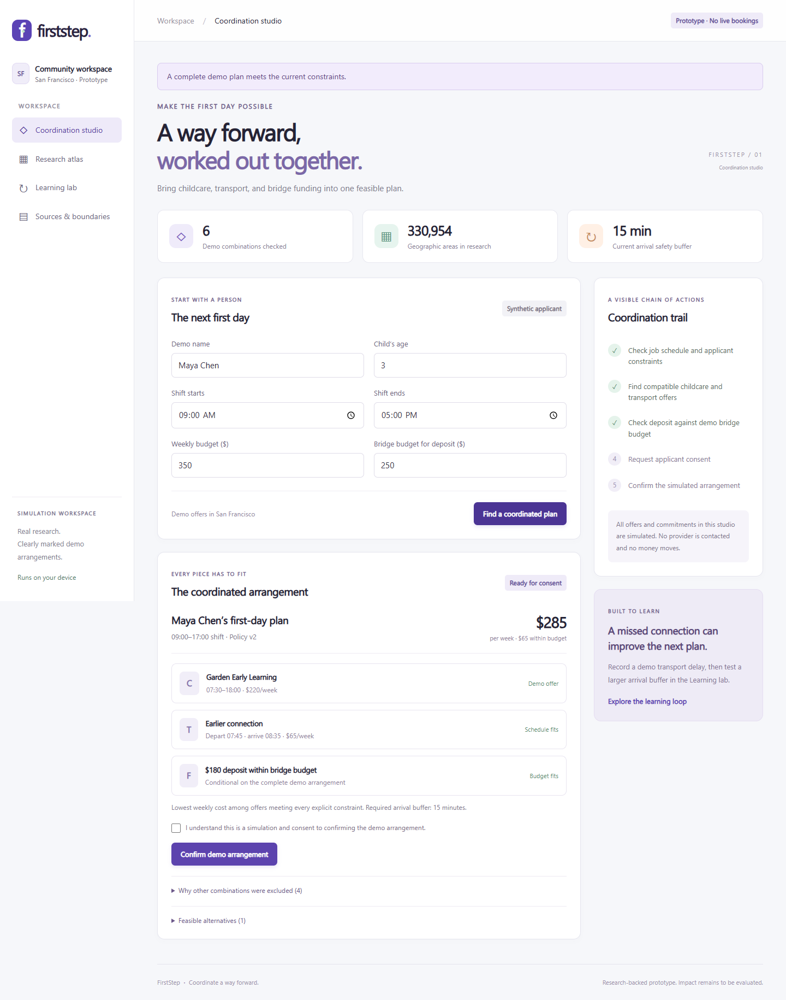

# FirstStep

**Coordinate childcare, transport, and bridge funding so a first day at work can happen.**

FirstStep is a runnable hackathon prototype with a constrained planning engine, a public-data explorer, and a tested policy-improvement loop. All applicant cases, service offers, confirmations, and outcomes in the coordination studio are **synthetic**. The research explorer uses real public-source records.



## Run in one command

Python 3.11 or newer. No runtime packages, API keys, or cloud accounts required.

```sh
python -m firststep.server
```

Open **http://127.0.0.1:8080**. Use `--port 8090` to select another port. Run commands from the repository root.

## The three-minute demo

1. In **Coordination studio**, keep the synthetic applicant's defaults and select **Find a coordinated plan**. The planner checks six childcare/transport combinations and selects the lowest-cost feasible bundle: $260 per week.
2. Check the simulation-consent box and confirm the demo arrangement.
3. Record a **15-minute transport delay**. No external service is contacted.
4. In **Learning lab**, evaluate the proposed scheduling change. A fixed five-scenario suite compares the current policy with a 15-minute arrival buffer. The initial comparison has two late arrivals; the candidate has none and increases on-time completions from one to three. Two scenarios remain declined.
5. Create another plan. The adopted buffer changes the chosen connection; the new bundle costs $285 per week.
6. Confirm it and **simulate a provider withdrawal**. The engine excludes the withdrawn offer, checks a replacement, and requires fresh consent. If the budget cannot cover any valid replacement, it reports the blockers.

These are deterministic synthetic stress results, not measured employment or social-impact outcomes. The learner changes one bounded scheduling parameter; it does not rewrite code, train a model, change provider rules, or modify its evaluation suite.

## What is implemented

- Budget, deposit, age, drop-off, arrival, pickup, and withdrawn-offer constraints.
- Enumeration and transparent rejection reasons for all six combinations.
- Explicit consent, idempotent demo confirmation, persisted outcomes, and an audit trail.
- Provider-withdrawal replanning with renewed consent.
- Observed-delay evidence, candidate-policy evaluation, and gated promotion.
- Real county statistics and a historical California childcare-center directory.
- Optional full SQLite research database with tract and block-group search.
- Responsive, keyboard-accessible web interface; no external font or script requests.

## Real data included

The repository includes a small usable extract so a fresh clone works immediately:

| File | Contents |
| --- | --- |
| `data/county_profiles.csv` | 3,222 county/county-equivalent profiles from the 2020–2024 ACS |
| `data/ca_childcare_centers.csv` | 19,426 historical California center records across licensing statuses; the UI filters source-listed LICENSED records |
| `data/data_dictionary.csv` | Census labels and original variable names |
| `data/manifest.json` | Full database source URLs, checksums, row counts, and validation results |

Provider records are dated **May 25, 2025**. They are not a live directory. Licensed capacity is not a vacancy count. Census negative sentinel values are retained in source data and displayed as unavailable; published margins of error are shown where selected. Geographic levels overlap and must not be added together. Parental-employment fields count **children**, not parents.

The full database contains **1,499,965 source rows** across subject tables, including data for **330,954 unique geographic areas**, **48,308 historical childcare-price records**, and **39,184 California licensing records**. Repeated geographies across subject tables are not unique people. Provider records are not linked to Census geographies by guessed matches.

### Install the full database

The 304 MB SQLite database is distributed as a ~75 MB release asset rather than committed to Git history. Authenticate `gh` for this private repository, then:

```sh
gh release download research-v1 --repo am101596-sketch/firststep --pattern FirstStep_Database.zip --dir data
python scripts/install_database.py data/FirstStep_Database.zip
python -m firststep.server
```

The installer verifies the archive's SHA-256, SQLite integrity, and expected geography count. An existing database is replaced only after validation. Alternatively, point `FIRSTSTEP_RESEARCH_DB` to an existing full database. The explorer opens it read-only. Price and family-home tables are available through SQL; the web interface currently exposes area profiles and center search.

## Research basis and unresolved assumptions

Childcare barriers are documented. A [St. Louis Fed analysis of 2024 survey data](https://www.stlouisfed.org/on-the-economy/2025/may/economics-child-care-state-level-analysis) reports that 16% of mothers with children under six who wanted work were not actively searching because they could not arrange childcare. This is not 16% of all mothers.

That evidence does not quantify the portion caused by sequencing failures, prove willingness to pay, or validate conditional reservations. Existing platforms such as [Unite Us](https://uniteus.com/products/closed-loop-referral-system/) already provide social-service coordination. FirstStep's coordinated-commitment mechanism is a product hypothesis, not a claim of worldwide novelty. [SFUSD's rules](https://www.sfusd.edu/sfusds-early-education-department-handbook/section-20-enrollment-costs-fees/22-sfusds-early-education-application) include parents seeking employment, so having a job is not a universal prerequisite for childcare assistance.

A real pilot needs participating providers with verified rules, availability, reservation authority, and funding. Start with a workforce partner and review failed starts to distinguish coordination delays from unavailable capacity or money. Evaluate on-time starts, staff effort, failed arrangements, and subsequent employment retention against a suitable comparison.

## Architecture

```text
Browser: static HTML / CSS / JavaScript
    -> localhost HTTP API (Python standard library)
        -> pure constraint planner and fixed stress evaluator
        -> local SQLite demo-state store
        -> read-only research SQLite or bundled CSV fallback
```

Demo state persists in `data/state.sqlite`, which Git ignores. The server binds only to loopback, validates loopback Host headers, rejects cross-origin mutations, limits JSON payloads, and applies a restrictive content security policy. It has no production authentication or authorization model. Do not expose it on a public network or enter real applicant information. There are no live booking, payment, benefit-submission, or messaging integrations.

## Tests

```sh
python -m unittest discover -s tests -v
```

Tests cover planner constraints, impossible cases, withdrawal recovery, consent and idempotency, persistence, policy gates, real-data fallback, and HTTP request handling. GitHub Actions runs the suite on Python 3.11–3.13.

## Data provenance and licensing

- **U.S. Census Bureau:** [2020–2024 ACS five-year Detailed Tables](https://www.census.gov/programs-surveys/acs/data/summary-file.2024.html), B01003, B19013, B23025, B23008, and B08201. Keep the period, geographic level, and uncertainty attached to estimates.
- **U.S. Department of Labor Women's Bureau:** [National Database of Childcare Prices](https://www.dol.gov/agencies/wb/topics/featured-childcare), 2008–2022. [Technical report](https://www.dol.gov/sites/dolgov/files/WB/National-Database-of-Childcare-Prices-Technical-Report.pdf) explains units, missingness, and estimation.
- **California Department of Social Services:** [Community Care Licensing Facilities](https://publish.data.ca.gov/dataset/community-care-licensing-facilities). The catalog identifies Creative Commons Attribution licensing. The bundled center CSV retains original source fields. UI filtering, SQLite conversion, and derived research views are project modifications. No government endorsement is implied.

Application code is MIT licensed. Source datasets retain their own terms and attribution requirements; the application license does not replace them.
